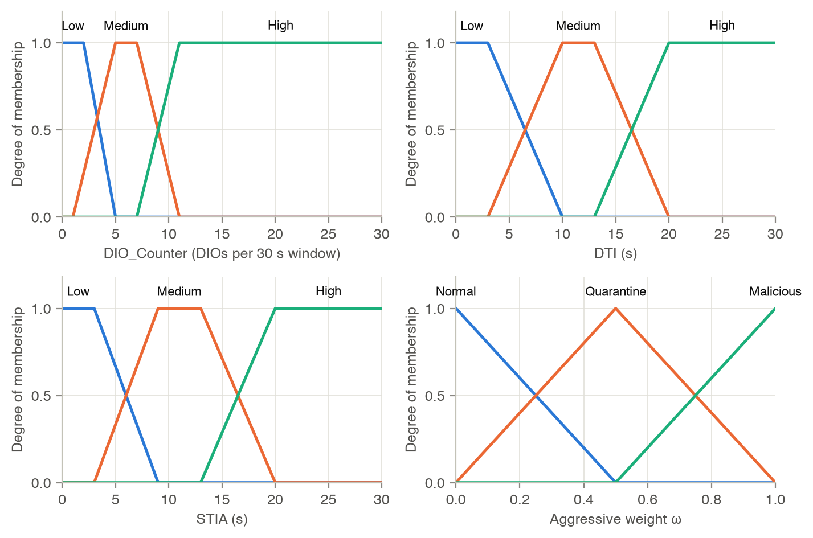
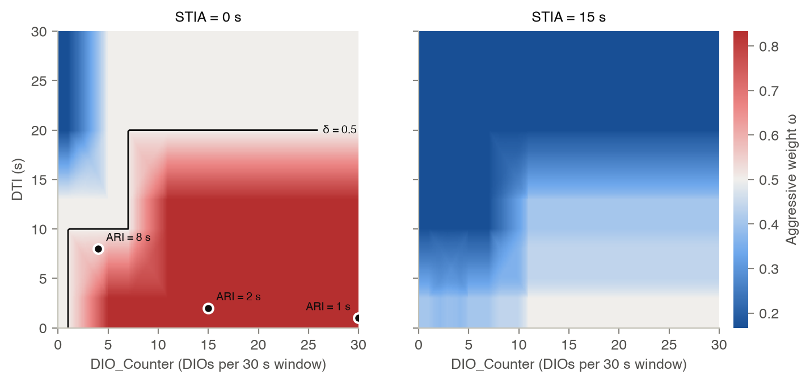
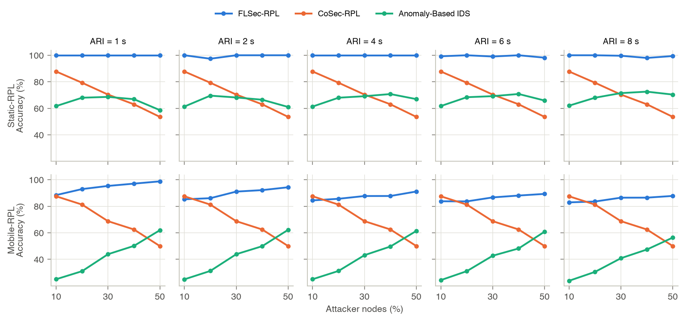
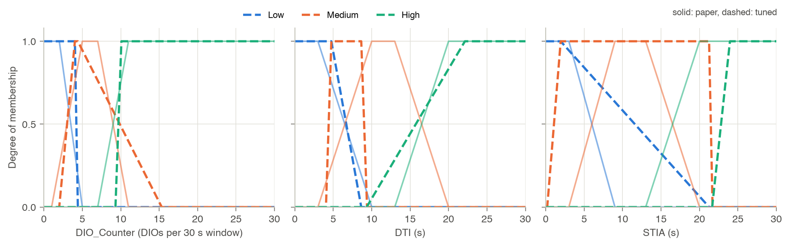
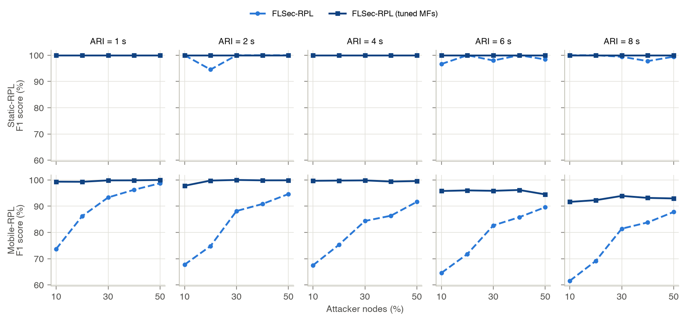

# FLSec-RPL: Fuzzy Logic Intrusion Detection for RPL

Re-implementation of FLSec-RPL (Kim et al., 2024), a fuzzy logic intrusion detection scheme against
DIO neighbor suppression attacks in RPL-based IoT networks, a reproduction of its main detection
experiment, and an extension that tunes the input membership functions with differential evolution.

## Student Information

| | |
|---|---|
| Student | Arda Aydın (1306230121) |
| Course | Fuzzy Logic (Bulanık Mantık), term project |
| Instructor | Tolgahan Öztürk |

## Original Paper

C. Kim, C. So-In, Y. Kongsorot, and P. Aimtongkham, "FLSec-RPL: a fuzzy logic-based intrusion
detection scheme for securing RPL-based IoT networks against DIO neighbor suppression attacks,"
*Cybersecurity*, vol. 7, art. no. 27, 2024. [doi:10.1186/s42400-024-00223-x](https://doi.org/10.1186/s42400-024-00223-x)

The authors did not release code or data. Everything in this repository is implemented from the
description, equations, tables and figures of the paper.

## Problem Description

RPL builds a tree (DODAG) rooted at a border router. Nodes advertise their rank in DIO messages,
whose timing is controlled by the Trickle algorithm: while the network is stable the interval
between DIOs doubles up to about 17.5 minutes, and any inconsistency resets it to about 4 s.

In a DIO neighbor suppression attack, a compromised node re-broadcasts a captured DIO, unmodified
and under its own address, at a fixed interval (1-8 s). The copies fill the Trickle redundancy
counter of the neighbors, so they stop sending their own DIOs and new nodes cannot join. Every copy
is also processed, which costs energy, and a victim may even pick the attacker as its parent.

The hard part of detection is separating slow attackers (a few DIOs per window) from legitimate
nodes whose Trickle timer was just reset and which therefore send a short burst of DIOs.

## Method

FLSec-RPL runs independently on every legitimate node and on the root. Time is split into 30 s
observation windows.

1. **Phase I, tracking.** For every neighbor: number of DIOs in the window (`DIO_Counter`), the
   last inter-DIO interval (`DTI`), and `STIA`, the RMSE between each interval and its prediction by
   exponential smoothing (alpha = 0.1). A replaying attacker has a constant interval, so its STIA is
   close to zero, while the Trickle intervals of a legitimate node keep doubling. Nodes announce
   Trickle resets with an RDT message, which sets an RDT flag at their neighbors.
2. **Phase II, fuzzy detection.** A Mamdani fuzzy system maps (DIO_Counter, DTI, STIA) to an
   aggressive weight omega in [0, 1]. A neighbor is suspicious when omega > 0.5.
3. **Phase III, validation and blocking.** A suspicious neighbor is quarantined and re-tested. It
   is blocked once it has been detected MD times, where MD and the quarantine period decay
   exponentially with omega (MD = 6 at omega = 0.5, MD = 1 at omega = 1). Neighbors with an RDT flag
   get the most tolerant setting. Blocks last 300, 600 and 1200 s; the fourth block is permanent.

## Fuzzy System Architecture

| | Low | Medium | High |
|---|---|---|---|
| DIO_Counter (DIOs per window) | (0, 0, 2, 5) | (1, 5, 7, 11) | (7, 11, 30, 30) |
| DTI (s) | (0, 0, 3, 10) | (3, 10, 13, 20) | (13, 20, 30, 30) |
| STIA (s) | (0, 0, 3, 9) | (3, 9, 13, 20) | (13, 20, 30, 30) |

- Inputs: trapezoidal sets (a, b, c, d) on [0, 30]; values outside are clipped.
- Output: aggressive weight with triangular sets Normal (0, 0, 0.5), Quarantine (0, 0.5, 1) and
  Malicious (0.5, 1, 1).
- Rule base: all 27 combinations (paper Table 2, [`src/flsec/config.py`](src/flsec/config.py)).
  Only three rules conclude Malicious, and all three require a Low STIA.
- Inference: min for AND. Defuzzification: Eq. 8 of the paper, the firing-strength weighted mean of
  the output-set centroids (1/6, 1/2, 5/6). This equals a zero-order Sugeno system, so omega never
  exceeds 5/6. The classical Mamdani centroid is also implemented and cross-checked against
  scikit-fuzzy in the tests.




The fuzzy engine is written from scratch with NumPy ([`src/flsec/fuzzy.py`](src/flsec/fuzzy.py)).

## Dataset

There is no external dataset: all data comes from the simulator in this repository.

- [`data/paper_reported_ranges.csv`](data/paper_reported_ranges.csv): accuracy, F1 and first-time
  detection ranges reported in the paper, used for the comparison.
- [`data/windows.csv.gz`](data/windows.csv.gz): 614,218 observation windows scored by FLSec-RPL in
  passive mode, used to tune the membership functions. See [`data/README.md`](data/README.md).

## Installation

Python 3.11 or newer (tested with Python 3.13.5 on macOS arm64).

```bash
git clone https://github.com/ArdaAyd/flsec-rpl-fuzzy-ids.git
cd flsec-rpl-fuzzy-ids
python -m venv .venv
source .venv/bin/activate          # Windows: .venv\Scripts\activate
pip install -r requirements.txt
```

## Requirements

numpy, scipy, pandas, matplotlib and tabulate, with exact versions in
[`requirements.txt`](requirements.txt). scikit-fuzzy and networkx are only needed by one test that
cross-checks the inference engine.

## How to Run

| Step | Command | Time (8 cores) |
|---|---|---|
| Unit tests | `python -m pytest` | < 10 s |
| Walk typical neighbors through phases I-III | `python experiments/baseline/fls_walkthrough.py` | < 5 s |
| Reproduction (2000 simulations) | `python experiments/baseline/run_reproduction.py` | ~6 min |
| Build the tuning dataset | `python experiments/proposed/make_dataset.py` | ~4 min |
| Tune the membership functions | `python experiments/proposed/tune_mfs.py` | ~6 min |
| Closed-loop test of the tuned sets | `python experiments/proposed/evaluate_tuned.py` | ~4 min |

All scripts are seeded and write their tables to `results/tables/` and their figures to
`results/figures/`.

## Repository Structure

```
src/flsec/
  config.py        paper parameters, membership functions, 27 rules
  fuzzy.py         Mamdani inference engine
  features.py      phase I: neighbor list, DTI, PTI, STIA
  validation.py    phase III: quarantine and blocking
  detectors.py     FLSec-RPL, CoSec-RPL and Anomaly-Based IDS
  simulator.py     discrete-event RPL control-plane simulator
  metrics.py       pair-level confusion matrix, first-time detection
  experiments.py   parallel grids, window collection
  optimize.py      membership function tuning (differential evolution)
  plotting.py      figures
experiments/baseline/   walkthrough and reproduction scripts
experiments/proposed/   dataset, tuning and evaluation scripts
data/                   paper ranges and the tuning dataset
results/                tables, figures and the tuned membership functions
tests/                  unit tests
report/                 technical report (PDF)
presentation/           slides (PDF)
```

## Reproduction Experiments

Re-creating the Contiki/Cooja setup of the paper would have required implementing the attack and
three detectors inside the ContikiRPL C stack and 1500 emulations of 30 minutes each. Instead, the
RPL control plane is modelled with a discrete-event simulator
([`src/flsec/simulator.py`](src/flsec/simulator.py)) that reproduces what the detectors observe:

- 1 root and 16 or 32 sensors, random connected placement in 150 m x 150 m, 50 m radio range,
  2 % packet loss, random MAC delay of 0-125 ms
- Trickle with Imin = 4.096 s, Imax = 17.5 min, k = 10; ranks grow by 256 per hop; Trickle resets on
  parent changes and multicast DIS
- random waypoint mobility at 1-2 m/s for Mobile-RPL
- attackers start at 90 s and replay the latest captured DIO every ARI seconds
- 10-50 % attackers, ARI of 1, 2, 4, 6 and 8 s, 30 minutes per run, seeds 0-4

Choices made where the paper is ambiguous:

| Topic | Choice |
|---|---|
| STIA | Eqs. 2-5 applied literally: PTI restarts in every window with PTI_1 = DTI_1, and DTI_1 is measured from the neighbor's previous DIO. A sensitivity variant uses only intervals inside the window. |
| DTI input | last interval of the window, clipped to 30 s |
| Blocking | blocked when the detection count reaches MD; omega upper bound 1 (paper Fig. 8A) |
| Accuracy and F1 | counted over (detector, neighbor) pairs that were in radio range after detection started; positive if the detector blocked the neighbor at least once |
| First-time detection | attack start until an attacker is first found suspicious by any detector |
| CoSec-RPL | Q3 + 1 IQR on cumulative DIO counts and a last-gap threshold sigma = 0.5 s, permanent block after 5 detections (the original paper prints 55). A variant with sigma = 10 s is also reported. |
| Anomaly-Based IDS | DIO count in the window above mean + standard deviation of all neighbors, blocked at once (implemented from the description in the FLSec-RPL paper) |

Results for FLSec-RPL (min-max over the 25 PAN x ARI settings, mean of 5 seeds):

| Scenario | Accuracy (%) ours / paper | F1 (%) ours / paper | First-time detection (s) ours / paper |
|---|---|---|---|
| 16 sensors, static | 97-100 / 97-100 | 95-100 / 91-100 | 48-62 / 27-45 |
| 16 sensors, mobile | 83-99 / 75-100 | 62-99 / 60-100 | 30-54 / 31-110 |
| 32 sensors, static | 100 / 96-99 | 100 / 93-99 | 55-61 / 27-69 |
| 32 sensors, mobile | 90-100 / 70-99 | 74-100 / 25-99 | 30-46 / 53-490 |

FLSec-RPL has the highest accuracy and F1 of the three methods in every scenario, as in the paper.
The full comparison, including both baselines, is in
[`results/tables/reproduction_vs_paper.md`](results/tables/reproduction_vs_paper.md).



Differences from the paper:

- First-time detection in Static-RPL is 10-20 s longer. With the literal STIA bookkeeping, the
  long silence before an attacker's first replay inflates STIA in the first attack window, so some
  attackers are only caught in the second window.
- In Mobile-RPL, FLSec-RPL's accuracy rises with the share of attackers, while the paper reports
  the opposite. Most of our mobile errors are false positives on legitimate nodes whose Trickle
  timers are reset by frequent parent changes; with more attackers there are fewer legitimate pairs.
- CoSec-RPL with its original 0.5 s threshold never fires when the replay interval is at least 1 s.
  With sigma = 10 s its F1 values are close to those reported for CoSec-RPL in the paper.

## Proposed Extension

The paper's membership functions come from expert knowledge, and the paper does not show how
sensitive the detector is to them. In our Mobile-RPL runs, 89 % of FLSec-RPL's errors with
16 sensors were false positives: on average 6.7 legitimate nodes per run were blocked by at least
one neighbor. In the window data, legitimate windows that were wrongly flagged had a median STIA of
1.9 s (quartiles 1.2-2.7 s) while attacker windows had 0.06-0.19 s, yet the paper's Low STIA set
is fully true up to 3 s and partly true up to 9 s.

The extension tunes only the breakpoints of the nine input sets and keeps everything else (27
rules, output sets, Eq. 8, delta = 0.5, phases I and III):

- Search space: per input, (c, d) of Low, (a, b, c, d) of Medium and (a, b) of High, 24 values in
  [0, 30]. Breakpoints stay ordered, the cores stay in the order Low < Medium < High and
  neighboring sets always overlap. The paper's sets are one point of this space.
- Objective: window F1 + 0.1 x (mean omega of attacker windows - mean omega of legitimate
  windows) - 0.02 x (mean breakpoint shift / 30). F1 dominates; the separation term favors
  confident decisions, which shortens blocking in phase III; the shift term keeps breakpoints that
  do not affect F1 at their expert values.
- Optimizer: SciPy differential evolution, 360 candidates per generation, 150 generations,
  mutation 0.5-1.0, recombination 0.7, paper sets in the initial population
  ([`src/flsec/optimize.py`](src/flsec/optimize.py)).
- Data: training seeds 100-102 (46,660 distinct windows after merging identical rounded inputs),
  validation seeds 103-104. The closed-loop test uses seeds 0-4, which never appear in the tuning
  data, and runs both variants on the same networks, attackers and mobility traces.

## Experimental Results

Tuned membership functions ([`results/tuned_mfs.json`](results/tuned_mfs.json)):

| | Low | Medium | High |
|---|---|---|---|
| DIO_Counter | (0, 0, 4.03, 4.41) | (1.99, 4.03, 4.41, 15.32) | (9.31, 10.08, 30, 30) |
| DTI (s) | (0, 0, 4.75, 8.64) | (4.05, 4.75, 8.64, 9.39) | (9.34, 22.13, 30, 30) |
| STIA (s) | (0, 0, 1.94, 21.25) | (0.19, 1.94, 21.25, 21.70) | (21.65, 23.96, 30, 30) |



Window level, validation seeds ([`results/tables/window_metrics.md`](results/tables/window_metrics.md)):

| Network | Membership functions | Recall | False positive rate | F1 |
|---|---|---|---|---|
| Static-RPL | paper | 0.964 | 0.024 | 0.980 |
| Static-RPL | tuned | 0.955 | 0.006 | 0.977 |
| Mobile-RPL | paper | 0.581 | 0.170 | 0.664 |
| Mobile-RPL | tuned | 0.756 | 0.055 | 0.835 |

Closed loop, test seeds, mean of 125 paired runs per row; p-values from the Wilcoxon signed-rank
test ([`results/tables/tuned_vs_paper.md`](results/tables/tuned_vs_paper.md)):

| Scenario | Accuracy, paper / tuned | F1, paper / tuned | Legitimate nodes blocked per run | First-time detection (s) |
|---|---|---|---|---|
| 16 sensors, static | 0.996 / 1.000 (p = 0.012) | 0.994 / 1.000 | 0.07 / 0 | 57.4 / 42.3 (p < 0.001) |
| 16 sensors, mobile | 0.887 / 0.986 (p < 0.001) | 0.819 / 0.974 | 6.71 / 0.23 | 37.0 / 41.4 (p < 0.001) |
| 32 sensors, static | 1.000 / 1.000 | 1.000 / 1.000 | 0 / 0 | 59.3 / 42.0 (p < 0.001) |
| 32 sensors, mobile | 0.962 / 0.991 (p < 0.001) | 0.917 / 0.984 | 9.96 / 0.02 | 37.1 / 39.6 (p = 0.007) |



What changed and why it helps:

- STIA Medium now starts at 0.19 s instead of 3 s, right above the STIA of replaying attackers.
  Any irregularity above about 0.2 s activates the Normal rules, so legitimate nodes with Trickle
  bursts stay below delta. This removes almost all false blocks in Mobile-RPL.
- STIA Low keeps its core below 1.94 s but its support grows to 21 s. In the first attack window
  STIA is inflated by the silence before the attack, and the attacker is now still partly Low, so
  it is found one window earlier in Static-RPL (first-time detection -15 to -17 s).
- The DTI sets moved down to the 1-8 s range of the replay intervals.

Costs: first-time detection in Mobile-RPL grows by 2.5-4.5 s, and the tuned Low and Medium STIA
sets overlap much more than the expert sets do.

## Limitations

- The simulator models the RPL control plane only. There is no channel contention or collision
  model (losses are a constant 2 %), so power consumption, end-to-end delay and packet delivery
  ratio, which the paper also reports, are not reproduced.
- The Anomaly-Based IDS is implemented from the two-sentence description in the FLSec-RPL paper,
  because the original paper was not accessible. CoSec-RPL's block threshold is printed as 55 in
  its paper; 5 is used here.
- Only non-spoofed attackers are simulated, as in the paper. RDT messages are not authenticated, so
  an attacker could forge them to obtain the most tolerant validation; this is not evaluated.
- The tuned membership functions are fitted to this simulator, a 30 s window and the default
  Trickle settings. Another network, window length or a real testbed would need new tuning data.
- The tuning objective is computed on single windows; closed-loop effects of phase III are only
  seen in the final evaluation.

## References

1. C. Kim, C. So-In, Y. Kongsorot, and P. Aimtongkham, "FLSec-RPL: a fuzzy logic-based intrusion detection scheme for securing RPL-based IoT networks against DIO neighbor suppression attacks," *Cybersecurity*, vol. 7, art. no. 27, 2024, doi: 10.1186/s42400-024-00223-x.
2. T. Winter et al., "RPL: IPv6 Routing Protocol for Low-Power and Lossy Networks," RFC 6550, IETF, Mar. 2012.
3. P. Levis, T. Clausen, J. Hui, O. Gnawali, and J. Ko, "The Trickle Algorithm," RFC 6206, IETF, Mar. 2011.
4. P. Perazzo, C. Vallati, G. Anastasi, and G. Dini, "DIO suppression attack against routing in the Internet of Things," *IEEE Communications Letters*, vol. 21, pp. 2524-2527, 2017.
5. A. Le, J. Loo, K. K. Chai, and M. Aiash, "A specification-based IDS for detecting attacks on RPL-based network topology," *Information*, vol. 7, no. 2, art. no. 25, 2016.
6. B. Farzaneh, M. A. Montazeri, and S. Jamali, "An anomaly-based IDS for detecting attacks in RPL-based Internet of Things," in *Proc. 5th Int. Conf. Web Research (ICWR)*, 2019, pp. 61-66.
7. A. Verma and V. Ranga, "CoSec-RPL: detection of copycat attacks in RPL based 6LoWPANs using outlier analysis," *Telecommunication Systems*, vol. 75, pp. 43-61, 2020.
8. E. H. Mamdani and S. Assilian, "An experiment in linguistic synthesis with a fuzzy logic controller," *International Journal of Man-Machine Studies*, vol. 7, no. 1, pp. 1-13, 1975.
9. R. Storn and K. Price, "Differential evolution: a simple and efficient heuristic for global optimization over continuous spaces," *Journal of Global Optimization*, vol. 11, no. 4, pp. 341-359, 1997.
10. P. Virtanen et al., "SciPy 1.0: fundamental algorithms for scientific computing in Python," *Nature Methods*, vol. 17, pp. 261-272, 2020.

## License

MIT, see [LICENSE](LICENSE).
